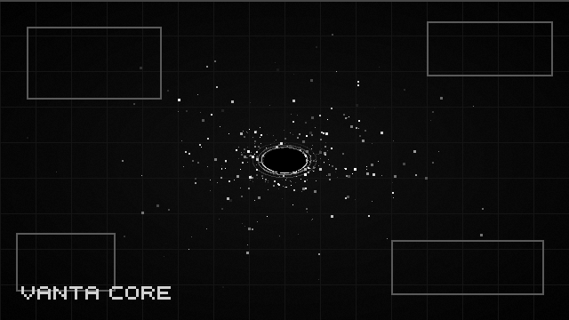
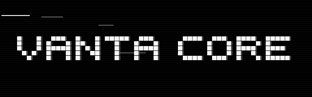
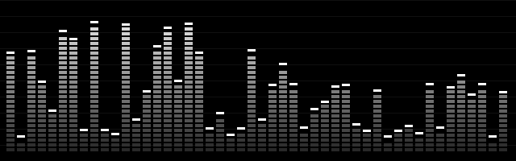
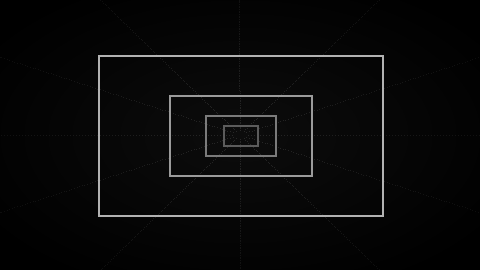

<p align="center"></p>

# VANTA CORE

> Brutalist monochrome kinetic art engine. 2,000,000 WebGL 2.0 particles, asyncio byte-stream simulator, ANSI black-hole terminal. Pure Python 3.11, zero dependencies.

<p align="center"></p>

## Run
```
python vanta_server.py       # page + live metrics, opens the browser
python vanta_terminal.py     # terminal animation (s = spike, q = quit)
python test_policy.py        # tests
```
Browser: drag = orbit, wheel = zoom, pointer = repel, click = pulse.

## Motion
<p align="center">
<br>
<br>

</p>

## How it works
```
Simulator -> analyse() -> RenderPolicy (fail-closed) -> Metrics
Metrics -> HTTP /metrics (127.0.0.1:8765) -> index.html (WebGL2)
Metrics -> vanta_terminal.py (ANSI)
```

| File | Role |
|---|---|
| `vanta_data_generator.py` | asyncio.Protocol stream simulator + `/metrics` |
| `vanta_render_policy.py` | fail-closed validation, density sorting |
| `vanta_terminal.py` | ANSI gravity animation |
| `vanta_server.py` | one-command launcher |
| `index.html` | WebGL2 swarm, 2M particles |
| `test_policy.py` | unit tests |

MIT License.
