<p align="center"></p>

# VANTA CORE

> Brutalist monochrome kinetic art engine. 2,000,000 WebGL 2.0 particles, asyncio byte-stream simulator, ANSI black-hole terminal. Pure Python 3.11, zero dependencies.

## Files
| File | Role |
|---|---|
| `vanta_data_generator.py` | asyncio.Protocol stream simulator + `/metrics` endpoint |
| `vanta_render_policy.py` | fail-closed validation, density sorting |
| `vanta_terminal.py` | ANSI gravity animation of the VANTA CORE header |
| `index.html` | WebGL 2.0 swarm, 2M particles, kinetic grid |
| `banner.svg` | animated README banner |

## Run
```
python vanta_data_generator.py   # terminal 1
python vanta_terminal.py         # terminal 2 (s = spike, q = quit)
open index.html                  # live metrics if generator is running
```
